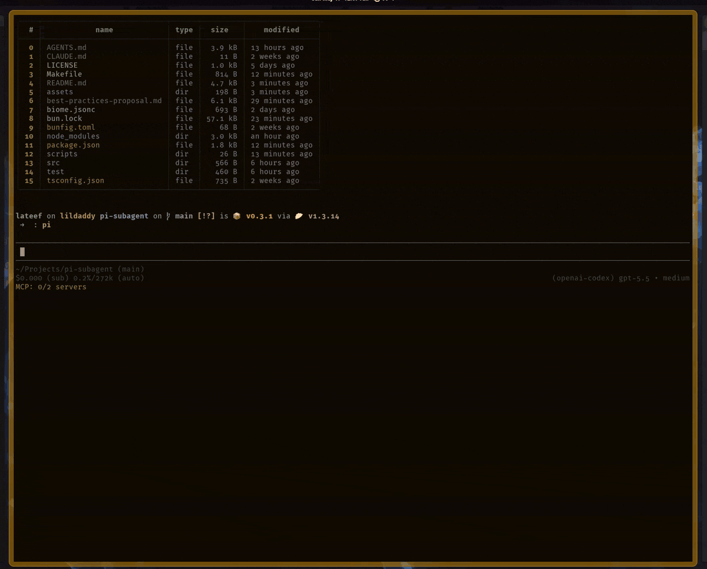

# Subagents for pi

> Official compatibility with the
> [SPAE framework](https://github.com/mystilleef/spae-framework).

Run sub-agents in [Pi](https://github.com/earendil-works/pi).



---

## Installation

**Install from `npm`:**

```sh
pi install npm:@mystilleef/pi-subagent
```

**Try temporarily without installing:**

```sh
pi -e npm:@mystilleef/pi-subagent
```

---

## Features

- **Asynchronous:** Agents always run in the background.
- **Parallel:** Run many agents simultaneously.
- **Isolated:** Each delegated task receives a separate context window.
- **Nested:** `Subagents` can spawn other `subagents`.
- **Simple:** No complex orchestration syntax.
- **Bloat-free:** No bundled agents. Write your own. Or use those from
  the [SPAE Framework](https://github.com/mystilleef/spae-framework).

---

## Usage

**Run an agent with an optional task:**

```text
/run agent [optional task]
```

**Examples:**

```text
/run spec implement google login screen
/run plan
/run inspect
/run build
/run verify
```

**Use natural language to launch agents in parallel:**

```text
use the work agent to write a poem about linux; use the commit agent to make
commits; use the query agent to summarize the project.
```

**Show active and completed jobs:**

```text
/jobs
```

**Cancel running `subagents`:**

```text
/cancel-subagent
```

**Show active-session subagent usage stats:**

```text
/stats
```

**Show descendant-inclusive stats for a specific root run:**

```text
/stats <run>
```

---

## _SPAE_ Workflow

The official extension for the
[SPAE Framework](https://github.com/mystilleef/spae-framework). The
framework provides pre-built agents and skills for a structured, or
orchestrated, workflow.

### Structured

| Phase | Agent                     | Purpose                                       |
| ----- | ------------------------- | --------------------------------------------- |
| 1     | `/run spec <requirement>` | Distill requirements into `SPEC.md`           |
| 2     | `/run plan`               | Decompose `SPEC.md` into an atomic task graph |
| 3     | `/run inspect`            | Perform gap analysis and optimize `PLAN.md`   |
| 4     | `/run build`              | Carry out tasks from `PLAN.md`                |
| 5     | `/run verify`             | Verify implementation against `SPEC.md`       |

### Orchestrated

| Agent                            | Purpose                                       |
| -------------------------------- | --------------------------------------------- |
| `/run orchestrate <requirement>` | Run all phases of the `SPAE` workflow         |
| `/run prepare <requirement>`     | Run preparatory phases of the `SPAE` workflow |
| `/run spawn`                     | Spawn build agents for each task in a plan    |

---

## Agent definitions

This extension ships no agents. Define agents as Markdown files with
YAML `frontmatter` and a Markdown system prompt body.

### Discovery locations

- User-global agents: `~/.pi/agent/agents/*.md`
- Project-local agents: nearest `.pi/agents/*.md`

### Example of an agent file

**PATH:** _~/.pi/agent/agents/lifehacks.md_

<!-- prettier-ignore-start -->
```md
---

name: lifehacks
description: Daily lifehacks
replace_prompt: true
context: false
thinking: xhigh
skills: false
extensions: pi-mcp-adapter
tools: read, grep, find, ls, mcp
---

# Role

Embody an expert philosopher and life coach. Your specialize in
_lifehacks_.

## Workflow

- Research and deliver 3 _profound_ and _transformative lifehacks_.
- Expound upon each of them.
- Emit unmodified result to the calling agent.

## Directives

- Forbid `copular` verb forms.
- **Minimum** words. **Maximum** signal.
- Keep prose vivid but terse.
- Optimize prose for token and context efficiency.
- Use lists and sub-lists over paragraphs and long sentences.
- Use elegant, well-structured, idiomatic markdown.

## Constraints

- Operate in read-only mode.
- Forbid all write operations.
- **NEVER** wrap the entire result in a code block.
```
<!-- prettier-ignore-end -->

### Required front matter

```yaml
name: review
description: Review code for correctness and maintainability.
```

### Optional front matter

```yaml
tools: read, bash, edit
skills: code-review
extensions: git-summary
context: false
thinking: medium
provider: deepseek
model: deepseek-v4-flash
temperature: 0.7
top_p: 0.9
replace_prompt: true
```

- `tools`: Specifies a comma-separated list of enabled tools. Omission
  defaults to the child process default `toolset`.
- `skills`: Specifies a comma-separated list of enabled skills. Setting
  `false` disables all skills. Omission inherits the active workspace
  skills.
- `extensions`: Specifies a comma-separated list of enabled extensions.
  Setting `false` disables all extensions except core subagent
  extensions. Omission inherits the active workspace extensions.
- `context`: Controls the inclusion of project context files,
  `AGENTS.md`. Setting `false` excludes default workspace files from the
  child context window.
- `thinking`: Controls the model thinking level (values: `off`,
  `minimal`, `low`, `medium`, `high`, `xhigh`, `max`). `xhigh` and `max`
  are model-specific, opt-in levels. The child runner clamps unsupported
  levels to supported values and prints warnings.
- `provider`: Specifies the model provider. Requires setting the `model`
  field. Omission of the `model` field when defining a `provider`
  invalidates the agent configuration.
- `model`: Specifies the model identifier. Agent-level model settings
  override parent settings.
- `temperature`: Sets the sampling temperature. Accepts numeric values
  between `0.0` and `1.0` inclusive. Incorrect values trigger warnings
  during discovery and the system ignores them.
- `top_p`: Sets the sampling top-p value. Accepts numeric values between
  `0.0` and `1.0` inclusive. Incorrect values trigger warnings during
  discovery and the system ignores them.
- `replace_prompt`: Set `true` to replace the child system prompt base
  with the agent body. Omitted or `false` appends the body to the
  existing system prompt, `SYSTEM.md`, preserving current behavior.
  Requires a non-empty agent body; `replace_prompt: true` with an empty
  or whitespace-only body fails discovery. **Warning:** `true` replaces
  pi built-in defaults and any project/global `SYSTEM.md`, including
  their safety and behavior guardrails.

---

## Tool

The extension also registers a `subagent` tool for model-driven
delegation.

**Inputs:**

- `agent`: agent name.
- `task`: task prompt for the child agent.
- `agentScope`: optional lookup scope, one of `user`, `project`, or
  `both`.
- `debug`: optional flag that requests child diagnostic details. Full
  child messages and raw internals require `PI_SUBAGENT_DEBUG_ENABLED=1`
  in the host environment.

---

## Usage accounting

Track tokens and cost across every subagent a run spawns, nested ones
included.

### Commands

- `/stats`: snapshot of the active session.
  - Header: runs, instances, tokens, cost.
  - Per-agent rows: instances, status counts, tokens, cost, summed
    duration.
  - Runs, most recent first: title, status, subtree tokens and cost,
    descendant tally.
- `/stats <run>`: one root run, matched by request ID or instance name;
  the latest match wins.
  - Header: instances, status counts, tokens, subtree cost, and the
    root's wall-clock duration once finished.
  - Tree: each instance with status, label, duration, and self cost;
    siblings in start order.
- `/jobs`: adds a session line (runs, instances, cost); cards with
  descendants add a tally.

```text
Session · 2 runs · 9 instances · ↑412k ↓38k R1.2M W40k · $3.1840
build   4 · ✓3 ✗0 ⊘0 ⟳1 · ↑210k ↓20k R800k · $1.6200 · 12m 4s
check   3 · ✓2 ✗1 ⊘0 ⟳0 · ↑90k ↓8k R300k · $0.7100 · 3m 10s
```

```text
merry-pelican (3f2a9c1e) · 4 instances · ✓3 ✗1 ⊘0 ⟳0 · ↑120k ↓9k · $0.4200 · 6m 41s
✓ orchestrate merry-pelican · 6m 41s · $0.0800
  ✓ build brave-otter · 2m 3s · $0.1500
  ✗ check jolly-panther · 58.2s · $0.0900
  ✓ check #2 calm-heron · 1m 12s · $0.1000
```

**Legend:** `✓` success, `✗` error, `⊘` cancelled, `⟳` running; `↑`
input, `↓` output, `R` cache read, `W` cache write (shown when nonzero).

### Cards

Progress, result, and `/jobs` cards share one layout; blank rows
separate blocks:

```text
⟳ orchestrate merry-pelican [running] 11 tools · 1% ctx · 6m 41s

  → subagent: check #3 jolly-panther - read: …/STATE.json

  5 spawned · check 3 (✓2 ⟳1) · build ✓1 · fix ✓1 · run $0.4213

opencode-go · minimax-m3 · high
```

- **Header**: status, label, `[<status>]`, tools, context, elapsed.
- **Body**: activity while running, error text on failure, first output
  line on success. Result cards show full output; `/jobs` cards show
  final output, error, or task.
- **Expanded progress**: adds `task: <preview>` and the descendant tree
  above the tally.
- **Tally**: cards with descendants only. Counts every descendant
  depth; running agents first, then failed or cancelled; overflow
  collapses into `+<K> more`.
- **Run cost**: `run $<total>` ends the tally and covers the whole
  subtree, self included. `/stats` omits it; its header already shows
  subtree cost.
- **Footer**: model on progress and `/jobs` cards; model, turns, and
  self-only cost on result cards.
- **Labels**: `<agent> <name>`; titles gain `#<n>` once an agent
  repeats among siblings: `build #3 brave-otter`.
- The result card replaces the progress card once posted. A cancelled
  top-level run keeps its progress card.
- Result cards render from saved details, so they survive reloads.
  Results from sessions predating usage accounting render without tally
  or run cost.
- Model-facing output and pi's footer exclude descendant usage.

### Sessions

- `/stats` covers the active session: runs restored from its saved
  entries plus runs launched since it started. `/new`, `/resume`,
  `/fork`, and `/reload` each rebuild accounting from the new session's
  entries.
- Root runs save one `subagent-usage` entry on completion. Restoration
  scans every entry, not only the active branch, and counts each run
  once.
- Forks inherit the runs their copied entries hold.

### Limits

- **50-node trees**: saved snapshots and displayed trees keep 50
  instances; the rest show as `+<count> earlier`. Totals stay exact.
- **Unsaved runs**: runs in flight at host exit, `/reload`, or a session
  switch, and runs whose save fails, drop out of `/stats`.
- **Snapshot order**: nested usage arrives as whole-subtree snapshots
  without versions. A stale snapshot arriving last can briefly regress
  totals until the next one.
- **Trimmed running instances**: trimmed descendants still running when
  their run ends count as cancelled, without duration.
- **Children without snapshots**: contribute only their own usage.
- **Provider costs**: costs come from provider reports, not independent
  auditing.

---

## Security

`Subagents` launch child `pi --json` processes. Agents, tools, and
extensions run with user permissions, so treat agent definitions like
executable automation.

**Trust guidance:**

- Review project-local agents before running them.
- Avoid delegating secrets unless the agent and tools need them.
- Treat child-agent prompts, tool arguments, `stderr`, and debug
  transcripts as potentially sensitive.
- Enable debug details only for trusted investigations. `debug: true` or
  `/run --debug` can expose child conversation transcripts, termination
  internals, and `stderr` only when the host explicitly sets
  `PI_SUBAGENT_DEBUG_ENABLED=1`.
- Prefer trusted repositories for shared agent definitions.
- Remember that child agents can call their configured tools.

---

## Configuration and limits

**Environment variables:**

- `PI_SUBAGENT_DEPTH`: current nested subagent depth counter set
  internally for child processes.
- `PI_SUBAGENT_MAX_DEPTH`: max nested subagent depth. Default: `5`.
  Values above `10` clamp to the internal ceiling `10`; deeper nesting
  increases cost, latency, and runaway delegation risk.
- `PI_SUBAGENT_AGENT_END_GRACE_MS`: child process grace period after
  `agent_end` before forced termination. Default: `250`.
- `PI_SUBAGENT_MAX_STDERR_BYTES`: max captured child `stderr` bytes.
  Default: `10000`.
- `PI_SUBAGENT_MAX_OUTPUT_BYTES`: max returned output bytes. Default:
  `50000`.
- `PI_SUBAGENT_MAX_OUTPUT_LINES`: max returned output lines. Default:
  `500`.
- `PI_SUBAGENT_DEBUG_ENABLED`: debug detail authorization. Set to `1` to
  allow `debug: true` or `/run --debug` to include sanitized child
  messages, termination internals, and `stderr`; unset values keep
  non-debug detail behavior.

Limit variables parse as positive integers. Empty, zero, negative,
decimal, `Infinity`, and non-numeric values fall back to defaults.

---

## Troubleshooting

**Missing agent:**

- Confirm the file lives under `~/.pi/agent/agents/` or the nearest
  `.pi/agents/`.
- Confirm `frontmatter` includes `name` and `description`.
- Confirm `/run` uses the `name` value, not the filename.

**Project-local agent prompt:**

- Pi may request confirmation before loading project-local agents when
  UI context exists.

**Nested subagent blocked:**

- Nested delegation hits the `PI_SUBAGENT_MAX_DEPTH` safety limit.
- Run the child task directly from the parent session instead.

**Truncated output:**

- Raise `PI_SUBAGENT_MAX_OUTPUT_BYTES` or
  `PI_SUBAGENT_MAX_OUTPUT_LINES`.
- Ask the child agent for a shorter summary.

---

## Development

**Install dependencies:**

```sh
bun install
```

**Run full verification:**

```sh
bun verify
```

**Check npm package contents:**

```sh
bun pack:smoke
```
