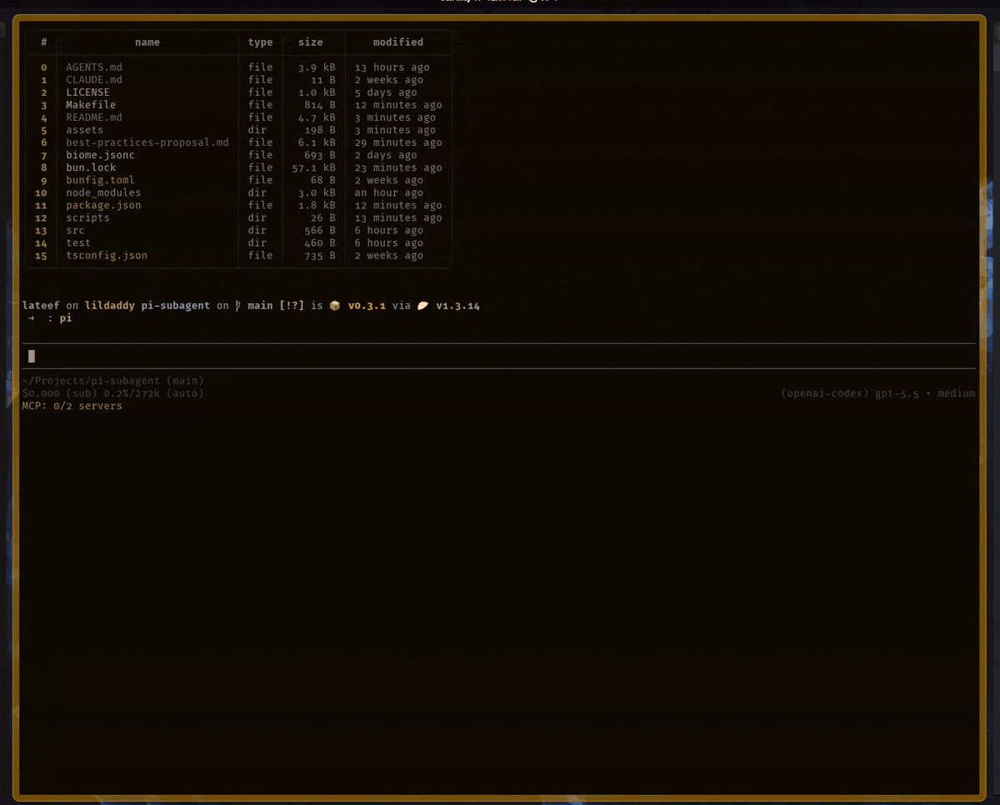

# Subagents for pi

> Official compatibility with the
> [SPAE framework](https://github.com/mystilleef/spae-framework).

Run sub-agents in [Pi](https://github.com/earendil-works/pi).



---

## Installation

**Install from `npm`:**

```sh
pi install npm:@mystilleef/pi-subagent
```

**Try temporarily without installing:**

```sh
pi -e npm:@mystilleef/pi-subagent
```

---

## Features

- **Asynchronous:** Agents always run in the background.
- **Parallel:** Run many agents simultaneously.
- **Isolated:** Each delegated task receives a separate context window.
- **Nested:** `Subagents` can spawn other `subagents`.
- **Simple:** No complex orchestration syntax.
- **Bloat-free:** No bundled agents. Write your own. Or use those from
  the [SPAE Framework](https://github.com/mystilleef/spae-framework).

---

## Usage

**Run an agent with an optional task:**

```text
/run agent [optional task]
```

**Examples:**

```text
/run spec implement google login screen
/run plan
/run inspect
/run build
/run verify
```

**Use natural language to launch agents in parallel:**

```text
use the work agent to write a poem about linux; use the commit agent to make
commits; use the query agent to summarize the project.
```

**Show active and completed jobs:**

```text
/jobs
```

**Cancel running `subagents`:**

```text
/cancel-subagent
```

**Show active-session subagent usage stats:**

```text
/stats
```

**Show descendant-inclusive stats for a specific root run:**

```text
/stats <run>
```

---

## _SPAE_ Workflow

The official extension for the
[SPAE Framework](https://github.com/mystilleef/spae-framework). The
framework provides pre-built agents and skills for a structured, or
orchestrated, workflow.

### Structured

| Phase | Agent                     | Purpose                                       |
| ----- | ------------------------- | --------------------------------------------- |
| 1     | `/run spec <requirement>` | Distill requirements into `SPEC.md`           |
| 2     | `/run plan`               | Decompose `SPEC.md` into an atomic task graph |
| 3     | `/run inspect`            | Perform gap analysis and optimize `PLAN.md`   |
| 4     | `/run build`              | Carry out tasks from `PLAN.md`                |
| 5     | `/run verify`             | Verify implementation against `SPEC.md`       |

### Orchestrated

| Agent                            | Purpose                                       |
| -------------------------------- | --------------------------------------------- |
| `/run orchestrate <requirement>` | Run all phases of the `SPAE` workflow         |
| `/run prepare <requirement>`     | Run preparatory phases of the `SPAE` workflow |
| `/run spawn`                     | Spawn build agents for each task in a plan    |

---

## Agent definitions

This extension ships no agents. Define agents as Markdown files with
YAML `frontmatter` and a Markdown system prompt body.

### Discovery locations

- User-global agents: `~/.pi/agent/agents/*.md`
- Project-local agents: nearest `.pi/agents/*.md`

### Examples

See [examples/agents](examples/agents) for sample agent definitions.

### Required front matter

```yaml
name: review
description: Review code for correctness and maintainability.
```

### Optional front matter

```yaml
tools: read, bash, edit
skills: code-review
extensions: git-summary
context: false
thinking: medium
provider: deepseek
model: deepseek-v4-flash
temperature: 0.7
top_p: 0.9
replace_prompt: true
```

- `tools`: Specifies a comma-separated list of enabled tools. Omission
  defaults to the child process default `toolset`.
- `skills`: Specifies a comma-separated list of enabled skills. Setting
  `false` disables all skills. Omission inherits the active workspace
  skills.
- `extensions`: Specifies a comma-separated list of enabled extensions.
  Setting `false` disables all extensions except core subagent
  extensions. Omission inherits the active workspace extensions.
- `context`: Controls the inclusion of project context files,
  `AGENTS.md`. Setting `false` excludes default workspace files from the
  child context window.
- `thinking`: Controls the model thinking level (values: `off`,
  `minimal`, `low`, `medium`, `high`, `xhigh`, `max`). `xhigh` and `max`
  are model-specific, opt-in levels. The child runner clamps unsupported
  levels to supported values and prints warnings.
- `provider`: Specifies the model provider. Requires setting the `model`
  field. Omission of the `model` field when defining a `provider`
  invalidates the agent configuration.
- `model`: Specifies the model identifier. Agent-level model settings
  override parent settings.
- `temperature`: Sets the sampling temperature. Accepts numeric values
  between `0.0` and `1.0` inclusive. Incorrect values trigger warnings
  during discovery and the system ignores them.
- `top_p`: Sets the sampling top-p value. Accepts numeric values between
  `0.0` and `1.0` inclusive. Incorrect values trigger warnings during
  discovery and the system ignores them.
- `replace_prompt`: Set `true` to replace the child system prompt base
  with the agent body. Omitted or `false` appends the body to the
  existing system prompt, `SYSTEM.md`, preserving current behavior.
  Requires a non-empty agent body; `replace_prompt: true` with an empty
  or whitespace-only body fails discovery. **Warning:** `true` replaces
  pi built-in defaults and any project/global `SYSTEM.md`, including
  their safety and behavior guardrails.

---

## Tool

The extension also registers a `subagent` tool for model-driven
delegation.

**Inputs:**

- `agent`: agent name.
- `task`: task prompt for the child agent.
- `agentScope`: optional lookup scope, one of `user`, `project`, or
  `both`.
- `debug`: optional flag that requests child diagnostic details. Full
  child messages and raw internals require `PI_SUBAGENT_DEBUG_ENABLED=1`
  in the host environment.

---

## Security

`Subagents` launch child `pi --json` processes. Agents, tools, and
extensions run with user permissions, so treat agent definitions like
executable automation.

**Trust guidance:**

- Review project-local agents before running them.
- Avoid delegating secrets unless the agent and tools need them.
- Treat child-agent prompts, tool arguments, `stderr`, and debug
  transcripts as potentially sensitive.
- Enable debug details only for trusted investigations. `debug: true` or
  `/run --debug` can expose child conversation transcripts, termination
  internals, and `stderr` only when the host explicitly sets
  `PI_SUBAGENT_DEBUG_ENABLED=1`.
- Prefer trusted repositories for shared agent definitions.
- Remember that child agents can call their configured tools.

**Webhook guidance:**

- Treat `PI_SUBAGENT_WEBHOOK_URL`, including any path or query token, as
  a secret.
- Spawned `Pi` subagents never inherit that setting.
- Plain `http:` exposes the token and every envelope field to the
  network; prefer `https:` on untrusted networks.
- Delivery failure stays silent. See [Notifications](#notifications).

---

## Notifications

Completion alerts leave through two independent channels: desktop alerts
and one optional JSON webhook receiver.

### Eligibility

- Only root subagents (depth `0`) alert; nested subagents stay silent.
- Completed (`success`) and failed (`error`) jobs alert; cancelled jobs
  send neither desktop alerts, webhooks, nor terminal bells.

### Dispatch

- **Batch** (default, and any `PI_SUBAGENT_NOTIFY_PER_JOB` value except
  exact `1`): sends one alert when removing the finished job empties the
  run registry. That final job supplies the alert content, so a cancelled
  final job sends nothing.
- **Per job** (exact `PI_SUBAGENT_NOTIFY_PER_JOB=1`): sends one alert at
  each qualifying root job's completion, and none at drain.
- `PI_SUBAGENT_DESKTOP_NOTIFICATIONS` controls desktop alerts only (exact
  `0` disables them; any other value or unset enables them) and never
  gates webhooks.
- Delivery runs detached and best effort: nothing awaits the `POST`, a
  fixed `5000 ms` timeout aborts slow requests, no retries follow, and
  process exit flushes no in-flight alert.

### Receiver

- Set `PI_SUBAGENT_WEBHOOK_URL` to one endpoint accepting a JSON `POST`.
- Trims the value and parses it as a `WHATWG` `URL`. Delivery requires an
  `http:` or `https:` scheme with a non-empty hostname and posts to the
  normalized `URL.href`.
- Unset, empty, whitespace-only, unparseable, non-HTTP(S), and hostless
  values disable delivery silently: no request, no error, no notice.
- Follows no HTTP redirects (`redirect: "manual"`); configure the final
  `POST` URL directly.

### Envelope

Each `POST` sends `Content-Type: application/json` with this object:

| Field                           | Value                                                                     |
| ------------------------------- | ------------------------------------------------------------------------- |
| `event`                         | `subagent.completed` on `success`; `subagent.failed` on `error`           |
| `title`                         | `Pi Subagent`                                                             |
| `message`                       | `<agent> finished in <duration>` or `<agent> failed after <duration>`     |
| `text`, `content`               | `${title}: ${message}` (native Slack/Mattermost and Discord message keys) |
| `agent`, `status`, `durationMs` | Completion metadata from progress state                                   |
| `timestamp`                     | ISO-8601 UTC completion time                                              |
| `instanceName`                  | Subagent job instance label; omitted when absent or empty                 |
| `urgency`                       | `normal` on `success`; `critical` on `error`                              |

The envelope carries completion metadata only. Prompts, task previews,
final output, error text, tool arguments, transcripts, and `stderr`
never cross this boundary, even with `PI_SUBAGENT_DEBUG_ENABLED=1`.

### Home Assistant

Point `PI_SUBAGENT_WEBHOOK_URL` at a Home Assistant webhook trigger
(`https://<host>/api/webhook/<webhook-id>`, or `http://` on a trusted LAN
or Tailscale network) and forward the envelope to the mobile app:

```yaml
- alias: Pi subagent completion
  triggers:
    - trigger: webhook
      webhook_id: <webhook-id>
      allowed_methods:
        - POST
  actions:
    - action: notify.mobile_app_<device>
      data:
        title: "{{ trigger.json.title }}"
        message: "{{ trigger.json.message }}"
        data:
          push:
            interruption-level: >-
              {{ 'time-sensitive' if trigger.json.urgency == 'critical' else
              'active' }}
```

- Home Assistant webhook triggers default to `local_only: true`; set
  `local_only: false` when posting from outside the local network.
- `data.push.interruption-level` targets iOS; Android ignores it and
  delivers a standard notification.

---

## Configuration and limits

**Environment variables:**

- `PI_SUBAGENT_DEPTH`: current nested subagent depth counter set
  internally for child processes.
- `PI_SUBAGENT_MAX_DEPTH`: max nested subagent depth. Default: `5`.
  Values above `10` clamp to the internal ceiling `10`; deeper nesting
  increases cost, latency, and runaway delegation risk.
- `PI_SUBAGENT_AGENT_END_GRACE_MS`: child process grace period after
  `agent_end` before forced termination. Default: `250`.
- `PI_SUBAGENT_MAX_STDERR_BYTES`: max captured child `stderr` bytes.
  Default: `10000`.
- `PI_SUBAGENT_MAX_OUTPUT_BYTES`: max returned output bytes. Default:
  `50000`.
- `PI_SUBAGENT_MAX_OUTPUT_LINES`: max returned output lines. Default:
  `500`.
- `PI_SUBAGENT_DESKTOP_NOTIFICATIONS`: desktop completion alerts. Exact
  `0` disables them; every other value, including unset, enables them.
- `PI_SUBAGENT_NOTIFY_PER_JOB`: alert timing. Exact `1` alerts per
  finished job instead of per run drain. Default: batch.
- `PI_SUBAGENT_WEBHOOK_URL`: optional JSON webhook receiver. See
  [Notifications](#notifications).
- `PI_SUBAGENT_DEBUG_ENABLED`: debug detail authorization. Set to `1` to
  allow `debug: true` or `/run --debug` to include sanitized child
  messages, termination internals, and `stderr`; unset values keep
  non-debug detail behavior.

Limit variables parse as positive integers. Empty, zero, negative,
decimal, `Infinity`, and non-numeric values fall back to defaults.

---

## Troubleshooting

**Missing agent:**

- Confirm the file lives under `~/.pi/agent/agents/` or the nearest
  `.pi/agents/`.
- Confirm `frontmatter` includes `name` and `description`.
- Confirm `/run` uses the `name` value, not the filename.

**Project-local agent prompt:**

- Pi may request confirmation before loading project-local agents when
  UI context exists.

**Nested subagent blocked:**

- Nested delegation hits the `PI_SUBAGENT_MAX_DEPTH` safety limit.
- Run the child task directly from the parent session instead.

**Truncated output:**

- Raise `PI_SUBAGENT_MAX_OUTPUT_BYTES` or
  `PI_SUBAGENT_MAX_OUTPUT_LINES`.
- Ask the child agent for a shorter summary.

---

## Development

**Install dependencies:**

```sh
bun install
```

**Run full verification:**

```sh
bun verify
```

**Check npm package contents:**

```sh
bun pack:smoke
```
